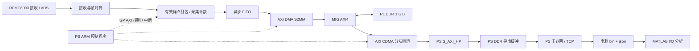

# PZ7035-FH + RFMC6000 接收采集架构草案

本方案依据本机板卡资料和当前 Vivado 工程整理。范围是接收数据接口、PL DDR 缓存、导出和 MATLAB 读取；AD9361 的频点、增益、滤波与工作模式配置暂不展开。采样率和通道数在实现时作为参数确定，下面的最高速率只用于估算资源。

## 1. 结论与当前工程

- 主板有独立的 **PS DDR 1 GiB 和 PL DDR 1 GiB**。采样数据优先存 PL DDR，PS DDR 用于程序、网络栈和导出缓冲。
- PL DDR 由两颗 `MT41K256M16TW-107IT:P` 组成，每颗 256M×16 bit，合计 32 bit 数据总线、1,073,741,824 byte。数据位位于 BANK33，地址/控制位位于 BANK34。
- `PZ_UART` 工程的 `design_1.bd` 已加入 SPI EMIO、接收接口、PL DDR MIG、DMA 与 PS 访问链路。wrapper 的 `DDR_*` 是 PS DDR，新增 `PL_DDR3_*` 是 PL DDR。具体实现和验证状态见[硬件说明](rfmc6000_capture_hardware.md)。
- 先实现有限长度采集：采集到指定样点数 → 等待全部写入 DDR → 停止 → 分块传给电脑。后续再考虑循环缓存、触发前采样或连续低速输出。
- AD9361 接收数字接口交付的是 I/Q 数据。本方案保存其数字接收链输出的复数基带/低中频样点；如果最终需求是某个模拟中频输入，输入频率适用性与频谱搬移方式后续另行确定。[AD9361 数据手册](https://www.analog.com/media/en/technical-documentation/data-sheets/AD9361.pdf)

## 2. 已有资料和可以复用的内容

| 资料 | 用途与限制 |
| --- | --- |
| `zynq035/04.核心板相关资料/` | 核心板手册、引脚及走线等长表、封装库；确认 PS/PL DDR 容量、BANK 电压和 PL DDR 管脚 |
| `zynq035/05.开发板原理图/` | 载板 FMC、JM1、时钟与供电；FMC 的原理图和核心板封装映射必须一起使用 |
| `zynq035/06.开发板教程/` | FMC 信号分配及开发流程 |
| `zynq035/1_FPGA/3_10_PZ_DDR/` | PL DDR 的 MIG 配置和存储器测试例程 |
| `zynq035/2_ARM/4_14_PZ_AXI_DMA/` | PS 控制 DMA 的参考 |
| `zynq035/2_ARM/4_10_PZ_NET0_LWIP/`、`4_16_PZ_AD7606_LWIP/` | 网口及采集数据发送的参考 |
| `zynq035/2_ARM/4_15_PZ_SD/` | SD 文件写入参考，可作为另一种离线导出方式 |
| `RFMC6000/1 原理图/` | FMC9361 原理图和 PCB DXF 压缩包 |
| `RFMC6000/2 用户手册/` | 开发指南、模块规格书、FMC 信号定义和供电要求 |
| `RFMC6000/3 FPGA测试例程/` | `adaloop_deepreads.zip`、Z19P/AXU9EG/AXU19EG/AXKU042/AXKU040 示例、AXU9EG 引脚表 |
| `RFMC6000/AD9361设计资料/` | AD9361 原厂设计资料压缩包，包含 UG-570、UG-671 等资料 |
| `RFMC6000/RFMC6000-3D模型.stp` | 模块机械模型 |

检查 `adaloop_deepreads.zip` 后发现：

- `axi_ad9361_dev_if_idelay.v` 使用 7 系列的 IBUFDS、IDELAYE2、IDDR、IDELAYCTRL，输出 `adc_valid` 和四组 12 bit I/Q 数据，可以作为接收接口移植的起点。
- 工程 `pldma_test.xpr` 的器件是 `xc7z035fbg676-2`，当前主板是 `xc7z035ffg900-2`。原 XDC 的 FPGA 管脚不能直接使用；AXU9EG 引脚表也只能复用“信号 → FMC 触点”的关系。
- 虽然文件名包含 `dma_demo`/`pldma`，检查到的参考 BD 没有接收 DMA 和 PL DDR MIG。它主要提供收发接口、控制和 ILA 观察；不能当成已经完成的 1 GiB 采集工程。
- 开发指南里的 MATLAB 流程是 ILA CSV 导出示例，适合验证数据排列，不适合大容量 DDR 数据保存。

载板 DDR 参考 `mig.prj` 使用 32 bit、时钟周期 1250 ps、200 MHz 输入、4:1 PHY 和 **NATIVE** 用户接口。1250 ps 对应 800 MHz DDR 时钟、1600 MT/s，理论总线带宽为 6.4 GB/s。该数字不代表本方案实测吞吐；实际要验证突发访问、仲裁和刷新期间的停顿。其原生 `app_*` 接口不能直接接 AXI DMA，建议保留板级管脚/时序参考，重新生成 **AXI4 接口的 MIG**。

## 3. FMC 接收管脚与电压

按 RFMC6000 信号表和载板原理图交叉核对，接收接口的映射如下。这里只记录映射依据，尚未生成或验证新 XDC。

| 接收信号 | FMC 信号名 | FPGA P / N 管脚 | BANK |
| --- | --- | --- | --- |
| RX_CLK | CLK0_M2C | AB27 / AC27 | 12 |
| RX_FRAME | LA06 | T30 / U30 | 13 |
| RXD[0] | LA08 | W29 / W30 | 13 |
| RXD[1] | LA10 | U24 / V24 | 13 |
| RXD[2] | LA04 | T24 / T25 | 13 |
| RXD[3] | LA03 | N28 / P28 | 13 |
| RXD[4] | LA05 | U22 / V22 | 13 |
| RXD[5] | LA02 | P21 / R21 | 13 |

电压需要结合实物核对：

- 核心板手册 2.10 说明 BANK10/11/12/13 可以通过电阻装配选择 1.8/2.5/3.3 V，并写明核心板出厂默认 3.3 V。
- 载板原理图的 FMC 页标注默认电平 1.8 V，核心板连接页要求将相关 BANK 从 3.3 V 改到 1.8 V。
- RFMC6000 规格书标明 VADJ 为 1.8～2.5 V。因此，**不能仅凭连接器插得上就确认电气兼容，也不能沿用 JM1 的 LVCMOS33 设置。**应核对实物 VADJ、BANK12/13 VCCO、差分终端和选用 I/O 标准。
- 参考工程使用的 LVCMOS25/LVDS_25 可作为评估 2.5 V 方案的起点；采用 1.8 V 时，需要单独检查接收终端及可能的发送/反馈时钟输出要求。
- JM1 使用 BANK10，可独立保留其供电设置；调整 FMC 数据 BANK 不等于将 25 路 JM1 输出整体改电平。
- RX_CLK 和 RX 数据位于不同 BANK，接收时钟的全局分配与输入时序需要在本器件布局布线后确认。

## 4. 推荐的数据通路



MIG 是存储器从接口，上图 MIG → CDMA 表示 CDMA 发起读访问获得 PL DDR 数据。实际 BD 中，AXI DMA 与 AXI CDMA 的主接口经 AXI 互连访问 MIG；CDMA 还必须能通过互连访问 PS HP 口对应的 PS DDR 地址空间。

### 接收、打包和写入

1. 用源同步 RX_CLK 接收 6 对数据和 RX_FRAME，完成输入延时、DDR 采样和 I/Q 解复用。可移植随板 7 系列接口，或使用 ADI `axi_ad9361`。
2. 仅在 `adc_valid` 表示完整新样点时打包。双通道模式的数据接口时钟通常是复数采样率的 4 倍，不能把每个接口时钟周期都当成新样点。[ADI 接口说明](https://analogdevicesinc.github.io/hdl/library/axi_ad9361/index.html)
3. 初版约定把每个有符号 12 bit 分量符号扩展到 16 bit，单通道打包为 32 bit，双通道为 64 bit。接收端的编码必须转换为该文件契约；不要无意左移 4 bit。
4. 采集控制按照有效样点计数，向异步 FIFO 写入数据和包尾标记，跨到 MIG 用户时钟域。FIFO 后端遵守 AXI Stream 握手；被背压时保持数据和标记稳定。
5. AXI DMA S2MM 把流写入 PL DDR。先配置并启动 DMA，再开放采集入口。初次使用简单模式采 1～4 MiB，验证后增加 SG 描述符链，每块例如 4 MiB，配置与数据包边界一致的 TLAST。
6. 大容量采集使用提前准备好的描述符链，不依赖 CPU 在每一块结束后即时重启 DMA。描述符可放在 PS 可访问的 AXI BRAM；也可放 PS DDR，但需增加 SG 主接口访问 PS HP 的路径并处理缓存。

AXI DMA 的长度字段受 IP 配置限制，最大 26 bit，即 67,108,863 byte；默认配置可能更小。4 MiB 分块也需要配置足够的长度位宽，不能直接下发一个 1 GiB 的简单传输。[AMD PG021](https://www.amd.com/content/dam/xilinx/support/documents/ip_documentation/axi_dma/v7_1/pg021_axi_dma.pdf)

AD9361 的采样流不能被 DDR 的背压暂停。FIFO 用于吸收短暂停顿，建议先预算 64～128 KiB，再根据实测最大停顿调整。双通道 61.44 MS/s 时，128 KiB 只能吸收约 267 μs 的积压。发生溢出、帧失锁或 DMA 错误应锁存状态，将该次采集标记无效，不能静默丢样。

### DDR 与时钟复位

- 独立生成 PL DDR MIG，采用板卡参考的内存型号、32 bit 总线和引脚；AXI 位宽、突发长度由 IP 配置与实际吞吐确定。
- 时钟域分为 RX 接收域、MIG `ui_clk` 域和 PS 控制域；控制跨域采用握手，数据跨域采用异步 FIFO。
- 7 系列 IDELAYCTRL 使用合规的 200 MHz 参考时钟；板上 200 MHz 时钟和 MIG 参考时钟可按 IP 要求规划共享缓冲。PS 100 MHz FCLK 用于控制，不能直接代替 RX 源同步时钟。[ADI 时钟接口说明](https://analogdevicesinc.github.io/hdl/library/axi_ad9361/index.html)
- 各域复位同步释放。等待 MIG `init_calib_complete`、输入延时控制器就绪及接收帧正常，才能允许采集。
- 采集状态建议为 `IDLE → ARM → CAPTURE → DRAIN → DONE → EXPORT`。达到输入样点数后仍须排空 FIFO，并等最后一次 DMA 写入完成，才报告 DONE。

### 从 PL DDR 导出到电脑

- PS 通过 M_AXI_GP 控制采集模块、DMA 和 CDMA，读取计数、溢出状态和完成中断。
- 完成采集后，AXI CDMA 从 PL DDR 读取数据，经 PS S_AXI_HP 写入 PS DDR 中的导出缓冲。HP 是访问 PS 内存的通道；PL DDR 仍由 MIG 管理。
- PS DDR 可预留两个 4 MiB 缓冲做交替搬运/发送，按内存布局实际分配，避免覆盖程序与网络栈。CPU 在 DMA 写入后、读取缓冲前做缓存失效；描述符与共享控制数据按方向做缓存清理，并保证缓存行对齐和所有权交接。
- 初版采用裸机 + lwIP TCP，将数据分块发送到电脑保存 `.bin`，附 `.json` 元数据。记录传输偏移、实际字节数并校验数据完整性。
- 千兆网线路上限为 125 MB/s，有效吞吐更低。它无法持续导出双通道高采样率数据，因此这里采用先采后传。传完 1 GiB 即使按线路上限也至少需要约 8.59 秒，实际需测量。
- SD/eMMC 可作为离线文件导出选项，写速率需实测；UART 用作控制和状态输出。

## 5. 缓存容量预算

这里每一路指一路复数接收通道，包含 I 和 Q。每个分量存 16 bit，则：

`写入速率 = Fs × 接收通道数 × 4 byte`

`缓存时间 = 可用 DDR 字节数 / 写入速率`

| 每通道复数采样率 | 单通道写入速率 | 单通道 1 GiB 时间 | 双通道写入速率 | 双通道 1 GiB 时间 |
| --- | --- | --- | --- | --- |
| 10 MS/s | 40 MB/s | 26.84 s | 80 MB/s | 13.42 s |
| 30.72 MS/s | 122.88 MB/s | 8.74 s | 245.76 MB/s | 4.37 s |
| 61.44 MS/s | 245.76 MB/s | 4.37 s | 491.52 MB/s | 2.18 s |

MB/s 使用十进制，GiB 使用二进制。表中按整块 1 GiB 计算，保留区域会缩短时间；初版只使用 512 MiB 时，时间减半。双通道 12 bit 紧凑打包可以节省 25% 空间，但初版采用 int16 更容易核验和在 MATLAB 中读取。

已搭建的硬件统一按 64 bit 保存 I1/Q1/I2/Q2，单路模式将第二路补零，仍占 8 byte/样点。表中单路 4 byte 的时间对应后续紧凑单路格式优化，当前实现应按双路栏估算。

## 6. 文件格式与 MATLAB

双通道 `.bin` 约定：小端、有符号 int16、按样点交错。

```text
I1[0], Q1[0], I2[0], Q2[0], I1[1], Q1[1], I2[1], Q2[1], ...
```

每个双通道样点 8 byte。对应 64 bit 打包时，从最低 16 bit 到最高 16 bit 依次为 I1、Q1、I2、Q2。单通道文件每样点 4 byte，只有 I1、Q1。

JSON 至少包含：`sample_rate_hz`、`channels`、`sample_count`、`dtype`、`endianness`、`component_order`、`overflow`、`frame_error`、触发信息和工程版本。记录的是实际有效样点数；采样率最终必须与接收配置一致，不能凭接口时钟直接推断。RF 配置确定后再增加频点和增益等元数据。

以下示例读取双通道文件的前 1,000,000 个样点：

```matlab
meta = jsondecode(fileread('capture.json'));
assert(meta.channels == 2);
fid = fopen('capture.bin', 'rb', 'ieee-le');
assert(fid >= 0, '无法打开采样文件');
cleanup = onCleanup(@() fclose(fid));
N = min(1000000, meta.sample_count);
v = fread(fid, [4, N], 'int16=>double');
assert(size(v, 2) == N, '采样文件长度不足');
x1 = complex(v(1,:), v(2,:));
x2 = complex(v(3,:), v(4,:));
Fs = meta.sample_rate_hz;
% 后续按 Fs 做频谱、时域、互相关等分析。
```

完整 1 GiB 原始 int16 文件转成双精度复数后，样点本体约需 4 GiB 内存，叠加读取矩阵和 FFT 工作区会更多。大文件使用分块 fread 或 memmapfile，避免一次性转换全部数据；数据存 bin，元数据存 JSON。

## 7. 落地顺序

1. 核对实物 FMC 供电、BANK 电压和管脚，搭建 PL MIG，先通过 DDR 地址/数据模式测试；覆盖超过 512 MiB 的地址，排除只验证了半块内存或地址映射别名的情况。
2. 用 PL 内部递增计数器代替 AD9361 数据源，打通 FIFO → DMA → PL DDR → CDMA → PS 缓冲，检查连续性与校验值。先验证 1～4 MiB，再扩大到 128/512 MiB。
3. 打通 TCP 导出和 MATLAB 文件读取，核验通道排列、符号、样点数量与文件长度。
4. 接入 RFMC6000 LVDS 接收接口，使用已知数据模式检查帧对齐和输入时序；确认后再做真实信号采集。AD9361 配置在这一步另行确定。
5. 在目标速率下测 FIFO 最高占用、DDR 最长停顿、DMA 错误与计数一致性，最后扩大到可用的完整 DDR 区域。

现有 KEY1 可以作为人工触发入口；其消抖会引入延迟。如果需要与 25 路 JM1 的 RIS 控制状态精确关联，应在 PL 中记录输出状态、采集起点和样点计数，而不是依赖 PS 软件先后调用来保证同步。

## 8. 主要本地依据

- [核心板使用手册，2.10/2.11/2.12](</home/yyz/ALLdoc/zynq035/04.核心板相关资料/3.PZ7035-PZ7045-PZ7100核心板使用手册/璞致PZ7035-7045-7100核心板使用手册.pdf>)：BANK 电压和 PS/PL DDR 容量、引脚。
- [载板原理图，第 3、18 页](</home/yyz/ALLdoc/zynq035/05.开发板原理图/璞致PZ7035-FH PZ7045-FH PZ7100-FH平台开发板原理图.pdf>)：核心板连接、FMC 电平和触点映射。
- [RFMC6000 规格书](</home/yyz/ALLdoc/RFMC6000/2 用户手册/RFMC6000 datasheet V1.0.pdf>)：采样规格、FMC 信号、供电要求。
- [RFMC6000 开发指南](</home/yyz/ALLdoc/RFMC6000/2 用户手册/RFMC6000模块开发指南.pdf>)：接口示例和 ILA/MATLAB 流程。
- [PL DDR MIG 参考配置](/home/yyz/ALLdoc/zynq035/1_FPGA/3_10_PZ_DDR/PZ_DDR.srcs/sources_1/ip/mig_7series_0/mig_7series_0/mig.prj)。

这份文档记录架构和容量预算；实际硬件实现、综合检查及剩余上板验证事项见[硬件说明](rfmc6000_capture_hardware.md)。
