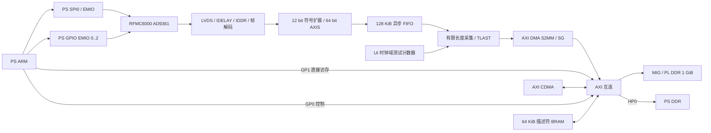

# PZ7035-FH 接收存储硬件

工程：`zynq/z035/PZ_UART.xpr`，器件：`xc7z035ffg900-2`，Vivado：2020.2。
本次在现有 `design_1` 上增加 SPI EMIO、接收接口、MIG、DMA 和 PS 访问通路。AD9361 寄存器初始化、PS 采集驱动和网口导出程序留待后续。

## 硬件连接



- PS SPI0 配置为 EMIO，使用 SS0；SSIN 接常高，输出缓冲遵守 PS 三态信号。
- PS GPIO 的 EMIO[0:2] 分别连接 RESETB、ENABLE、TXNRX；Zynq-7000 软件 GPIO 编号通常对应 54、55、56。
- GP0 地址窗口用于访问控制寄存器与描述符 BRAM。GP1 提供独立的完整 1 GiB PL DDR 地址窗口。
- AXI DMA 使用 S2MM + Scatter/Gather，64 bit 数据流，长度字段 26 bit。默认每 4 MiB 或本次最后一个样点输出 TLAST。
- AXI CDMA 为简单模式，64 bit，访问 MIG 和 PS HP0，可从 PL DDR 分块搬到 PS DDR。
- DMA 的描述符主接口访问 64 KiB AXI BRAM，不占用 PL DDR。每个描述符按 64 byte 对齐；1 GiB 采集按 4 MiB 分块需要 256 个描述符。
- 中断拼接输入 0 是 S2MM DMA，输入 1 是 CDMA。软件应使用新导出平台的 `xparameters.h`，不要沿用旧平台的设备编号和中断号。

## 地址表

| 资源 | PS 地址 | 范围 |
| --- | --- | --- |
| PL DDR | `0x80000000`～`0xBFFFFFFF` | 1 GiB，通过 GP1 |
| AXI DMA | `0x40400000` | 64 KiB |
| AXI CDMA | `0x40410000` | 64 KiB |
| 采集控制 AXI GPIO | `0x41200000` | 64 KiB |
| 采集状态 AXI GPIO | `0x41210000` | 64 KiB |
| 描述符 BRAM | `0x42000000`～`0x4200FFFF` | 64 KiB |

CDMA 的 PS DDR 目标窗口是 `0x00000000`～`0x3FFFFFFF`。这表示可寻址范围，**并不表示整段都可以拿来当缓冲**；实际导出缓冲必须按 linker/系统内存布局分配，避开程序、栈、网络栈和保留区。

AXI 互连中的不必要目标已按主接口排除：S2MM 只能写 PL DDR，SG 只访问描述符 BRAM，CDMA 访问 PL DDR 与 PS DDR，PS 访问控制、BRAM 与 PL DDR。

## 控制和状态

控制 GPIO 两个通道均为 32 bit 输出，默认全零。

| 地址 | 含义 |
| --- | --- |
| `0x41200000 + 0x00` | CONTROL |
| `0x41200000 + 0x08` | SAMPLE_COUNT，完整 64 bit 样点数 |
| `0x41210000 + 0x00` | STATUS，只读输入 |

CONTROL：

| 位 | 功能 |
| --- | --- |
| 0 | ARM，上升沿启动一次采集；再次触发前写回 0 |
| 1 | TEST，1 选择内部测试数据，0 选择 LVDS 接收数据 |
| 2 | SINGLE_RX，1 使用参考接口的单接收通道帧格式，0 使用双通道格式 |
| 3 | RX_CLEAR，1 保持接收解码、接收 FIFO 和错误标志复位；0 释放；只能在采集空闲时切换 |
| 12:8 | 输入 IDELAY 的共同延时值，0～31；只在空闲时修改，实际值需输入测试校准 |

STATUS：

| 位 | 功能 |
| --- | --- |
| 0 | ACTIVE，采集源仍在提交数据 |
| 1 | SUBMITTED，最后一拍已被 DMA 的 AXIS 接口接收 |
| 2 | MIG_READY，DDR 校准完成 |
| 3 | RX_OVERFLOW，接收流无法被暂停，FIFO 满后丢样会锁存此位 |
| 4 | RX_FRAME_ERROR，接收帧格式异常，锁存 |
| 5 | RX_DELAY_READY，输入延时控制及接收启动流水线就绪 |
| 6 | TEST_MODE，本次选用的测试源 |
| 7 | BAD_ARM，长度非法、正在采集、MIG 未就绪或真实接收尚未就绪时拒绝启动 |

状态逐位同步到 PS 控制时钟域。软件应以 DMA 的完成状态确认写入已结束，不能仅凭 SUBMITTED 宣布数据已落入 DDR。错误位在 RX_CLEAR 或对应复位后清除；发生溢出或帧错误的真实采集不能用于连续样点分析。

SAMPLE_COUNT 支持 1～134,217,728，对应最多 1 GiB。本版始终每样点存 8 byte；单接收模式把第二路 I/Q 补零，所以其存储时间也按每样点 8 byte 计算。前一份架构预算中单路 4 byte 是后续可选优化，本版未实现该紧凑单路格式。

## 数据排列

真实接收数据从最低 16 bit 到最高 16 bit 依次为 `I1,Q1,I2,Q2`，每个 12 bit 分量按补码符号扩展到 int16，不左移。小端文件排列为：

```text
I1[0], Q1[0], I2[0], Q2[0], I1[1], Q1[1], I2[1], Q2[1], ...
```

测试源从样点索引 0 开始，低 32 bit 为索引，高 32 bit 为 `索引 XOR 0x5A5A5A5A`。它运行在 MIG 用户时钟域，不依赖 9361 的接收时钟，受 DMA 背压控制。

## 软件启动次序

1. 加载更新后的 PL bitstream，等待 STATUS.MIG_READY。
2. 测试 DDR 链路时选择 TEST；真实接收时先设置 RX_CLEAR，再完成后续的 AD9361 SPI/GPIO 初始化，配置帧模式和延时，释放 RX_CLEAR 后等待接收就绪。
3. 保持 ARM=0，写 SAMPLE_COUNT。先在 BRAM 中准备完整的 S2MM 描述符链，目标地址从 `0x80000000` 起，每块 4 MiB，最后一块可以较短。DMA 包边界必须与硬件 TLAST 一致。
4. 启动 S2MM，控制字段稳定至少数个跨域周期后再设置 ARM=1。PS 可使用微秒级等待和内存屏障保证配置已传播。
5. 等待最后一个描述符完成，检查 DMA 错误、实际字节数、溢出及帧错误。
6. 直接经 GP1 小范围读取检查，或用 CDMA 搬到 PS DDR 缓冲。DMA 写入缓冲后，CPU 读取前处理缓存失效；CPU 写共享内存/描述符后确保写入已完成。

首轮建议只采 1～4 MiB。直接通过 GP1 可验证存储内容，批量导出再使用 CDMA。

## 时钟、电压与待上板验证事项

- 板载 H9/G9 差分 200 MHz 输入同时供 MIG 和接收 IDELAY 参考；MIG 配置继承厂商 DDR 型号、引脚、1250 ps 时钟周期和 32 bit 宽度，改为 256 bit AXI 用户接口。
- 数据接收使用 RX_CLK 源同步时钟，跨异步 FIFO 到 MIG UI 时钟；PS FCLK0 100 MHz 用于控制。各域有相应复位和同步器。
- 用户已确认 FMC VADJ 与 BANK12/13 VCCO 均为 1.8 V，SPI/GPIO 使用 LVCMOS18。
- 接收 HR BANK 使用 LVDS_25 输入，1.8 V 下关闭 DIFF_TERM。需要核对实物外部差分终端及输入电平；不能在该 VCCO 下直接打开内部 100 Ω DIFF_TERM。[AMD UG471](https://docs.amd.com/api/khub/documents/IbGcnPFe6eF19RHma_Y~IA/content)
- RX XDC 声明最高双通道接口时钟约 245.76 MHz；接收输入延时 min/max 尚未确定，需按最终接口模式、AD9361 输出时序及 PCB 偏斜补齐，并校准 IDELAY。这版不代表接收时序已经签核。
- 主板原 PS 配置的 NAND tRC/tWC 为 5 ns，修改 PS 时会算出不合法的一周期。脚本将两项设为 30 ns，保留原外设使能和 MIO 路由；原文件已备份。

## 文件与验证

- BD：`zynq/z035/PZ_UART.srcs/sources_1/bd/design_1/design_1.bd`
- 脚本：`zynq/z035/scripts/build_rfmc6000_capture.tcl`，使用已有 PS/KEY BD 构建一次；已构建的工程直接打开使用。
- MIG 板级输入：`zynq/z035/scripts/mig/pz7035_pl_ddr.prj`
- 新约束：`zynq/z035/PZ_UART.srcs/constrs_1/new/rfmc6000_pl_ddr.xdc`
- RTL：`rfmc_spi_io.v`、`rfmc6000_rx.v`、`rfmc_rx_pack.v`、`rfmc_capture_axis.v`
- 原始工程备份：`zynq/z035/backups/before_rfmc6000_capture/`
- RTL 仿真覆盖：符号扩展及排列、AXIS 背压稳定、FIFO 溢出锁存、帧错误锁存、样点计数、分块/最终 TLAST、非法长度拒绝、真实数据源选择。

本次验证结果：

- Vivado 2020.2 `validate_bd_design` 通过，IP 输出及 wrapper 已生成。
- 两个 XSim 测试分别输出 `CAPTURE_AXIS_TEST_PASS` 和 `RX_PACK_TEST_PASS`；复现命令为 `bash zynq/z035/tests/run_rfmc_tests.sh`。
- 完整工程 `synth_1` 和 `opt_design` 通过；优化网表已保存为 `zynq/z035/reports/capture_opt.dcp`。
- DRC 无 Error/Critical Warning。剩余一条厂商 MIG 内部 PLL 输出缓冲 Warning（REQP-1709）和两条 BRAM write-first Advisory；新增 FIFO 的 RAM 异步控制警告已通过同步复位消除。MIG 的剩余警告需要结合后续实现检查。
- 综合、DRC、引脚和资源报告位于 `zynq/z035/reports/`。当前资源占用约 21% LUT、12% 寄存器、10% BRAM，没有超出器件容量。

板上 DDR 校准、全地址测试、真实接收时序、实际吞吐和 CDMA 搬运仍需后续验证。旧 XSA/Vitis 平台不包含新增硬件；综合/实现后需重新导出 XSA 并更新软件平台。
