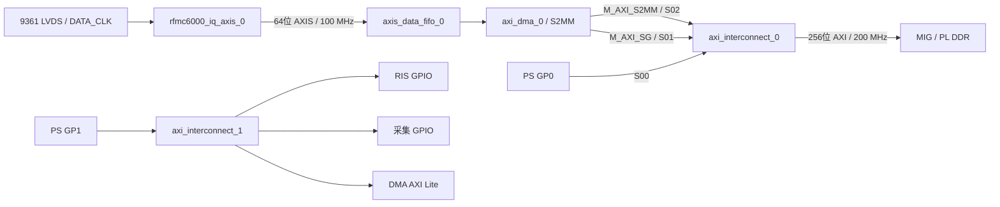

# RFMC6000 / AXI DMA 当前 BD 检查与地址规划

本页记录首次地址规划及接线方案；用户已完成两路 DMA 地址和状态回读。
最新保存设计的检查结果见 [BD/XDC 复查](RFMC6000_BD_XDC_RECHECK.md)。

检查时间：2026-10-13。检查当前磁盘保存的
`PZ_UART.srcs/sources_1/bd/design_1/design_1.bd`、IP XCI、wrapper、手写顶层及
活动 XDC。Vivado 2020.2 的验证在临时副本中完成；未保存修改到原 BD/XPR。
副本只把 MIG 的相对 PRJ 路径改为同一配置文件的绝对路径，以便独立打开。

## 已正确连接



- 捕获模块 M_AXIS → AXIS FIFO S_AXIS → DMA S_AXIS_S2MM。
- DMA M_AXI_S2MM → DDR Interconnect S02，M_AXI_SG → S01；PS GP0 → S00。
- DMA AXI Lite、两个 GPIO 由 PS GP1 的控制互连接入。
- 采集模块 m_axis_aclk、FIFO、DMA 的 Lite/SG/S2MM 和互连 S00/S01/S02
  输入侧均为 PS FCLK0 100 MHz。
- MIG ui_clk 200 MHz → DDR 互连 ACLK/M00_ACLK、IDELAY ref_clk200。
- 100 MHz 侧使用 rst_ps_fclk0 复位，MIG 侧使用 proc_sys_reset_ddr；验证传播后
  PS 外部复位为低有效，DDR 的 calib_complete 接低有效辅助复位，极性正确。
- DMA s2mm_introut → xlconcat_0/In0 → PS IRQ_F2P，PS 已启用 PL 中断输入。
- 采集 GPIO 当前 1 位输出 → capture_arm；8 对差分输入已引到 BD 外部端口。

验证过程中 Vivado 正确插入了三路输入侧的 AXI 时钟转换器，以及 GP0/SG 的
32→256 位、S2MM 的 64→256 位宽度转换器。

## 参数检查结果

保存的 XCI 在初次读取时仍显示 FIFO 8 位、无 TKEEP/TLAST，DMA 32 位。
执行 `validate_bd_design` 后自动传播为：FIFO 64 位、TKEEP/TLAST 开启，DMA
Stream/内存写口均为 64 位。这些缓存初始值不是实际接线错误，需要在原工程
验证后保存，生成最新输出产品。

| 项目 | 验证后的当前值 | 建议值 |
| --- | --- | --- |
| 捕获内部 FIFO | 4096 beat | 保持 |
| 捕获包长 | 4096 组 IQ / 32768 字节 | 保持 |
| 输入延迟 | 七路 tap 8 | 作为板上 PN 校准起始值 |
| 外部 AXIS FIFO 位宽 | 64 位，TKEEP/TLAST 开启 | 保持 |
| 外部 FIFO 模式 | 同步时钟，FIFO_MODE=1（普通 FIFO） | 保持 |
| 外部 FIFO 深度 | 512 beat / 4 KiB 数据 | 建议 16384 beat / 128 KiB |
| DMA 模式 | 仅 S2MM，SG 开启，无 Control/Status Stream | 保持 |
| DMA S2MM Stream/Memory 宽度 | 64/64 位 | 保持，由互连转换为 MIG 256 位 |
| DMA 地址宽度 | 32 位 | 保持 |
| DMA Buffer Length Register Width | 14 位 | 建议 23 位；32 KiB 一包一个 BD 至少需要 16 位 |
| DMA burst size | 16 | 可先保持，按实测吞吐调整 |

14 位长度最大为 16383 字节，15 位最大为 32767 字节。SG 可以用多个小缓冲描述符
承接同一包；本方案选择一个 32768 字节缓冲对应一个完整包，因此扩大长度字段。
参考 [AMD AXI DMA PG021，S2MM_CONTROL / Scatter Gather Descriptor](https://www.amd.com/content/dam/xilinx/support/documents/ip_documentation/axi_dma/v7_1/pg021_axi_dma.pdf)。

在每通道 61.44 MSPS 时，双 RX 的数据率为 491.52 MB/s。当前外部 4 KiB 仅能
增加约 8.3 us 的空缓冲停顿余量；建议外部 128 KiB 约为 266.7 us，内部 32 KiB
另约为 66.7 us。实际余量取决于已有占用，持续吞吐仍需实测。

## 地址编辑器配置

当前只给 PS Data 分配了 MIG/控制寄存器，两路 DMA 主口的 MIG 段均未分配。
Vivado 当前验证给出两条 BD 41-1356 Critical Warning；原 BD 仍需补这两条映射。

| 地址空间 / 目标 | 基地址 | 范围 | 处理 |
| --- | --- | --- | --- |
| PS Data / MIG | 0x40000000 | 1 GiB，至 0x7FFFFFFF | 保持 |
| axi_dma_0/Data_SG / MIG memaddr | 0x40000000 | 1 GiB，至 0x7FFFFFFF | 新增 |
| axi_dma_0/Data_S2MM / MIG memaddr | 0x40000000 | 1 GiB，至 0x7FFFFFFF | 新增 |
| PS Data / RIS GPIO | 0x80010000 | 当前 128 字节 | 保持 |
| PS Data / 采集 GPIO | 0x80020000 | 当前 128 字节 | 保持 |
| PS Data / DMA AXI Lite | 0x81000000 | 当前 64 KiB | 保持 |

SG 和 S2MM 是两个访问内存的 AXI 主口，都映射同一块 MIG；各主口地址相同
不会产生冲突。SG 描述符放在哪里、采样数据放在哪里，由软件在这块内存里
分区，不能把 DMA 的控制寄存器地址 0x81000000 当作 SG 描述符地址。

建议软件分区（不需要额外添加 Address Editor 段）：

| 用途 | 起止地址 | 容量 |
| --- | --- | --- |
| SG 描述符保留区 | 0x40000000–0x401FFFFF | 2 MiB |
| IQ 数据区 | 0x40200000–0x7FFFFFFF | 1022 MiB |

描述符按 64 字节对齐。数据缓冲按 32 字节或更高对齐，每个缓冲 32768 字节；
该分区能容纳 32704 个完整数据包，其描述符占 2093056 字节，落在保留区内。
初次上板只使用其中少量完整包进行验证。CPU 程序仍放 PS DDR。
缓存开启时，描述符交付 DMA 前 clean、完成后 invalidate；数据缓冲也需正确
处理所有权和缓存，不能让 CPU 的脏缓存覆盖 DMA 写入的数据。

脚本 `scripts/configure_rfmc6000_dma_memory.tcl` 提供上述两路映射、23 位长度、
16384-beat 外部 FIFO 和显式 64 位/TKEEP/TLAST 设置。在当前 BD 打开后执行：

```tcl
source /home/yyz/work/RIS/zynq/z035/scripts/configure_rfmc6000_dma_memory.tcl
```

脚本不补下面列出的接线，不保存 BD，也不生成 wrapper/bitstream。在临时副本
应用并重新验证已通过，两条未分配地址告警消失。

SG 当前直接访问 MIG 的路线可保留，无须为了 SG 另加 BRAM。MIG 的 AXI 数据
宽度为 256，NARROW_BURST=0，不能笼统认为宽度转换会处理任何窄事务：
互连 upsizer 的打包要求 A*CACHE[1]=1。已检查安装的 Vivado 2020.2 SG RTL，
当前单通道 SG 的 AR/AWCACHE 固定为 0011，互连会配置 32→256 upsizer。
仍应在板上验证 SG 描述符取回和状态写回；首次测试失败时观察 MIG 前端
AxSIZE、AxLEN、WSTRB 和响应，不直接将失败归为地址问题。
参考 [AMD PG059：AXI Upsizer](https://docs.amd.com/r/en-US/pg059-axi-interconnect/AXI-Upsizer)。

## 尚未完成的接线与集成

### 1. 六个采集状态没有接出去

`rx_ready、frame_locked、capture_active、overflow、frame_error、delay_error`
在当前 BD 全部没有连接。只看 DMA 完成，无法确认 ADC 输入侧是否已经漏样或错帧。

建议把现有 axi_gpio_9361 改为双通道 GPIO，保留地址 0x80020000：

| 通道 / 位 | 方向 | 信号 |
| --- | --- | --- |
| GPIO1[0] | 输出 | capture_arm |
| GPIO2[0] | 输入 | rx_ready |
| GPIO2[1] | 输入 | frame_locked |
| GPIO2[2] | 输入 | capture_active |
| GPIO2[3] | 输入 | overflow |
| GPIO2[4] | 输入 | frame_error |
| GPIO2[5] | 输入 | delay_error |
| GPIO2[31:6] | 输入 | 26 位常数零 |

按用户确认，GPIO1 保持 1 位全输出，直接连接 capture_arm；GPIO2 为 32 位
全输入。xlconcat 配置 7 个输入：In0..In5 各 1 位，按表中顺序连接；In6 接
26 位 xlconstant 零，dout 接 gpio2_io_i[31:0]。六个捕获状态已经属于 100 MHz 域。
MIG 校准状态如另行观察，先同步到 100 MHz 域再接对应调试/状态输入。
可另接 100 MHz ILA 观察 Stream 握手和这些状态。

### 2. 按用户确认保留系统复位

当前捕获模块和外部 FIFO 只接系统 peripheral_aresetn。模块 ARM 锁存，
GPIO 拉低不能停止，也不能清除故障；DMA 软件复位不会自动复位采集模块。

不新增 GPIO 复位控制，保留 rst_ps_fclk0/peripheral_aresetn 到捕获模块 aresetn、
外部 FIFO s_axis_aresetn 的现有连接。GPIO1 只保留 bit0，启动前写 0，等待
ready/lock 并准备 DMA 后写 1。故障恢复或重新开始采集需要使现有系统 aresetn
真正拉低，或重新配置 PL；不把 DMA 软件复位当作整个采集链路复位。
整个流程保持 RIS 控制字和 AD9361 PS EMIO RESETB 的原定义。

有限采集还需定义完整包的停止边界。当前 RTL 没有包数限制，不能单靠关 DMA
或拉低 ARM 来实现无漏样的有限窗口；可后续加源端包计数停止，或在软件中
明确以已完成包为有效窗口，并定义复位时剩余 FIFO 数据的处理。

### 3. 新输入尚未穿过 wrapper / 手写顶层

BD 已有六个差分输入端口（共 16 位），但当前 design_1_wrapper.v 和
pz7035_top.v 仍没有 rx_clk_p/n、rx_frame_p/n、rx_data_p/n[5:0]。
需要重新 Create HDL Wrapper，并在手写 pz7035_top 增加这些输入及例化连接。
模块内部已有 IBUFDS，外部直接连接。

### 4. IO 与 CDC 约束尚未激活

当前 XPR 的活动约束文件仍只有 key_ctrl_55_jm1.xdc。补好顶层后加入：

- `PZ_UART.srcs/constrs_1/new/rfmc6000_iq_axis_io.xdc`：实际引脚、LVDS_25、DATA_CLK。
- `PZ_UART.srcs/constrs_1/new/rfmc6000_iq_axis_cdc.xdc`：手写三级同步器第一级例外；
  将其 SCOPED_TO_REF 设置为 rfmc6000_iq_axis。

旧 rfmc6000_pl_ddr.xdc 使用 rx_frame_in/rx_data_in 名称，与当前端口不一致，
应使用新的模板，避免同一输入时钟重复 create_clock。板级 DDR 输入时序约束
仍需按实际 AD9361 延迟和 PCB 偏斜补齐，并用 PN 测试码确认无误码窗口。

## 完成硬件后

原工程 Validate Design、保存、更新输出产品和 wrapper，完成顶层/XDC，再综合
和实现；重新导出含 bitstream 的 XSA、更新 Vitis 平台/BSP，生成 DMA/新 GPIO
驱动参数。软件先验证 MIG 读写和少量 SG 数据包，再进行连续采集。

审查记录：`reports/rfmc6000_dma_bd_review_summary.txt`。
检查与规划均未修改原 BD/XPR 的保存内容，不是上板 DMA/DDR 数据完整性验证。
