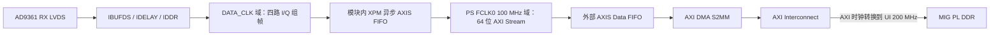

# RFMC6000 双通道 I/Q 采集与 DMA 接入方案

新增独立模块：`PZ_UART.srcs/sources_1/new/rfmc6000_iq_axis.v`。
接收 RTL、FIFO、DMA 和状态 GPIO 已接入现有 BD，两份 XDC 已加入工程；
最新 wrapper/手写顶层已引出 16 个 ADC 输入。2026-10-13 已修复整机实现中
接收模块的复位时序问题，重新综合、布局布线并生成 bitstream；详情见
`RFMC6000_TIMING_FIX.md`，BD/IO 检查见 `RFMC6000_BD_XDC_RECHECK.md`。
XSA 已随最新整机实现更新为 `pz7035_top.xsa`，包含新的 bitstream；
AD9361 在线检查软件保持原版本。

输入前端对齐本地 `adaloop_deepreads.zip` 的 7035 参考工程：
`axi_ad9361_dev_if_idelay.v`。保留 7 路 `IBUFDS → IDELAYE2(VAR_LOAD) →
IDDR(SAME_EDGE_PIPELINED)`，下降沿数据再寄存一次后与上升沿数据配对；
DATA、FRAME 使用相同的对齐流水线。默认 7 路均加载 tap 8，参考的
`HIGH_PERFORMANCE_MODE=FALSE` 也保持一致。

延迟值使用现有参数 `INPUT_DELAY_TAPS`，在 200 MHz 域启动加载；加载并稳定后
才跨域宣告就绪。没有直接复制参考中 100 MHz AXI 寄存器到 200 MHz LD/CNTVALUEIN
的跨域连接。本版本不新增在线调延迟端口，软件在线扫描可通过后续独立控制接口
实现；目前可通过参数或 AD9361 数字接口延迟寄存器调整。输出端保持异步 FIFO、
64 位 AXIS、故障锁存和停止机制。

## 接口与数据格式

模块直接接收 AD9361 的 RX_CLK、RX_FRAME 和 RXD[5:0] 共 8 对 LVDS。
要求芯片配置为双接收通道、LVDS DDR、周期性 RX_FRAME；标准帧序列为：

| DATA_CLK 周期 | FRAME（两个边沿） | I 的 6 位 | Q 的 6 位 |
| --- | --- | --- | --- |
| 0 | 11 | RX1 I[11:6] | RX1 Q[11:6] |
| 1 | 11 | RX1 I[5:0] | RX1 Q[5:0] |
| 2 | 00 | RX2 I[11:6] | RX2 Q[11:6] |
| 3 | 00 | RX2 I[5:0] | RX2 Q[5:0] |

默认 I 在下降沿、Q 在随后的上升沿，使用参考的 `IDDR(SAME_EDGE_PIPELINED)`，
再对下降沿数据额外寄存一次，拼成 `{previous_falling, rising}`。这一边沿关系
及数据对齐与 RFMC6000 参考接口一致。若硬件配置改变边沿选择，
可用 `I_ON_FALLING_EDGE=0` 对调 I/Q；这不替代采样时序校准。
模块不支持单通道帧格式或只在突发起始拉高一次的 FRAME 模式。

每个 AXI Stream beat 含 RX1/RX2 的一组完整复数样本，每个分量从有符号
12 位符号扩展为 16 位，不截位、不做抽取或幅度缩放：

| TDATA | 内容 | DDR 内每组样本的字节偏移 |
| --- | --- | --- |
| [15:0] | I1 | 0–1 |
| [31:16] | Q1 | 2–3 |
| [47:32] | I2 | 4–5 |
| [63:48] | Q2 | 6–7 |

`TKEEP=0xFF`；默认 `PACKET_SAMPLES=4096`，每 4096 组样本产生一次 TLAST，
每包 32768 字节。TLAST 与数据一起入 FIFO，反压期间保持不变。
数字接口提供的是 AD9361 内部滤波、抽取后的 I/Q 数据。

## 时钟、CDC 与复位



- `ref_clk200`：稳定、已缓冲的 200 MHz 时钟，用于 IDELAYCTRL 和 VAR_LOAD。
  复位保持至少 64 个参考周期；RDY 后加载七路 tap，并等待稳定，参考域登记的
  就绪信号经三级同步后在接收域使用。RDY 掉落异步清除该就绪信号，即使参考
  时钟停止也能在接收域检测到失锁。
- `rx_clk`：模块内部将差分 DATA_CLK 经 IBUFDS、BUFG 后用于 DDR 捕获。
- `m_axis_aclk`：接入 PS `processing_system7_0/FCLK_CLK0`，100 MHz。
  AXIS、外部 FIFO、DMA 数据/控制通路和采集控制 GPIO 都使用该时钟。
- `ref_clk200` 可接到 MIG `ui_clk`，先核实其实际频率确为
  200 MHz；这样无需在已有差分振荡器引脚上重复实例化输入缓冲。以后更改 MIG
  UI 频率时，需要为 IDELAYCTRL 另提供稳定的 200 MHz 参考时钟。
- I/Q 数据通过 `xpm_fifo_axis(independent_clock)` 跨域，禁止对数据总线逐位
  打拍。XPM 提供指针同步、FIFO 复位逻辑和对应的时序约束。
- `capture_arm` 由 PS FCLK0 100 MHz 域的控制寄存器驱动。模块先在该域登记，再
  三级同步到 RX 域。采集控制 GPIO 与 `m_axis_aclk` 使用同一 FCLK0。
- 状态位在 RX 域登记后分别三级同步到输出域；它们是独立电平，不能当作同一
  周期的原子状态快照。
- `aresetn` 复位整个采集模块和内部 FIFO。各时钟域异步断言、同步释放。
  正常释放复位前应保证三个时钟有效；DATA_CLK 尚未产生时可保持复位。
- IDDR 的 R/S 与 RFMC6000 参考工程一致，固定为 0，持续采样。复位仍清除后级
  DATA/FRAME 对齐寄存器、组帧状态和 FIFO；三级复位释放、FIFO 启动等待及完整
  FRAME 序列检查保证重新采集前刷新输入流水线，不会输出复位前的残留样本。
- 直接控制 FIFO RAM 读写使能的寄存器使用同步复位，防止异步复位断言改变
  RAM 控制引脚。接收时钟停止时，输出域仍屏蔽旧数据；接收时钟恢复后再完成
  FIFO 清空和启动。

配套 `PZ_UART.srcs/constrs_1/new/rfmc6000_iq_axis_cdc.xdc` 排除手写数据同步器
第一级 D 输入的异步路径，以及三个复位同步链直接接收 `aresetn` 的 CLR 引脚
恢复/移除检查。同步链级间路径和同步复位输出到后级逻辑仍正常计时。XPM 自己的
约束必须保留，不能用宽泛的时钟组异常覆盖其 Gray 指针的最大延迟/总线偏斜约束。

后续将文件加入工程时：

```tcl
set_property XPM_LIBRARIES {XPM_CDC XPM_FIFO XPM_MEMORY} [current_project]
# 在加入约束文件后，限定它只作用于此接收模块：
set_property SCOPED_TO_REF rfmc6000_iq_axis [get_files *rfmc6000_iq_axis_cdc.xdc]
```

## 启动与完整性

1. 软件完成 AD9361 参考时钟、双 RX 数字接口和接收通路初始化，确认 DATA_CLK
   及 FRAME 格式。当前的 SPI ID 检查软件还没有完成这些配置。
2. 复位采集模块及外部 FIFO，准备 DMA 描述符/目标缓冲区并启动 S2MM。
3. 等待 `rx_ready=1`、`frame_locked=1`，再将 `capture_arm` 置高。
4. ARM 在 RX 域锁存，之后连续采集完整 I/Q 组。ARM 拉低不会中途截断包；
   本版本停止/重启采集使用复位。复位会丢弃内部未搬完的数据，软件必须先定义
   采集窗口边界，不能把复位时的半包当作有效数据。

ADC 无法响应 TREADY。内部 FIFO 默认 4096 beat，约 32 KiB 有效数据缓冲；
还含随数据保存的 AXIS sideband。额外弹性寄存器保证 FIFO 入口反压时稳定。
接收器从完整 `11,11,00,00` 序列取得锁定，避免从半个样本开始输出。

| 状态 | 含义 |
| --- | --- |
| rx_ready | IDELAY 已就绪、FIFO 已启动 |
| frame_locked | 已观察到完整双 RX 帧序列 |
| capture_active | 已 ARM 且没有采集错误；不表示 DMA 已写完 DDR |
| overflow | 缓冲区无法接纳新样本，已发生漏样 |
| frame_error | 锁定后帧序列不符 |
| delay_error | 启动后 IDELAYCTRL 丢失 RDY |

三个错误位锁存到复位，并停止接纳新样本。已排队的数据继续遵守 AXIS 握手，
不会撤回一个被反压的有效 beat。任一错误都表示该次采集不能被认定为完整记录；
软件应处理/中止当前 DMA 包，清空采集和外部 FIFO 后重新开始。
有效记录还必须检查 DMA 完成状态、实际字节数及缓冲区边界。

## 后续 BD 接线

模块对外端口保持原有版本，不增加延迟配置 IO。在 BD 中使用 Add Module /
Refresh Module Reference 更新 RTL。已有模块引用可能保留旧的全零参数：
务必检查 `INPUT_DELAY_TAPS` 为 `35'h210842108`（七路 tap 8），
`I_ON_FALLING_EDGE=1`、`FIFO_DEPTH=4096`、`PACKET_SAMPLES=4096`。

### 每个模块端口

| 端口 | 方向 | 接入位置/含义 |
| --- | --- | --- |
| rx_clk_p / rx_clk_n | 输入 | 子板 RX_CLK_P/N，Make External，FPGA AB27/AC27；模块内已有 IBUFDS/BUFG |
| rx_frame_p / rx_frame_n | 输入 | 子板 RX_FRAME_P/N，Make External，FPGA T30/U30 |
| rx_data_p[5:0] / rx_data_n[5:0] | 输入 | 子板 RXD[5:0] 差分数据，Make External；逐位管脚见下表 |
| ref_clk200 | 输入 | 稳定的 200 MHz，全局缓冲后的 MIG ui_clk（当前频率）或 Clocking Wizard 输出 |
| m_axis_aclk | 输入 | PS processing_system7_0/FCLK_CLK0，100 MHz；后级 AXIS FIFO/DMA 同时钟 |
| aresetn | 输入，低有效 | 保留 100 MHz 域 proc_sys_reset 的 peripheral_aresetn，按用户确认不增加 GPIO 复位；释放前保证参考时钟稳定 |
| capture_arm | 输入，高有效 | 100 MHz 域采集 AXI GPIO 通道1 bit0，通道1保持1位全输出；0等待、置1开始并锁存；重新开始需现有系统复位 |
| rx_ready | 输出，100 MHz 域 | 接 100 MHz ILA 或新增状态 AXI GPIO 输入；延迟已加载且 FIFO 已启动 |
| frame_locked | 输出，100 MHz 域 | 接同一 ILA/状态寄存器；已观察到完整双 RX 帧 |
| capture_active | 输出，100 MHz 域 | 接同一 ILA/状态寄存器；已启动且无采集错误 |
| overflow | 输出，100 MHz 域 | 接同一 ILA/状态寄存器；FIFO 堵塞导致漏样，锁存至复位 |
| frame_error | 输出，100 MHz 域 | 接同一 ILA/状态寄存器；锁定后 FRAME 格式错误，锁存至复位 |
| delay_error | 输出，100 MHz 域 | 接同一 ILA/状态寄存器；运行后 IDELAYCTRL 失锁，锁存至复位 |
| m_axis_tdata[63:0] | 输出 | AXIS Data FIFO 的 s_axis_tdata[63:0] |
| m_axis_tkeep[7:0] | 输出 | FIFO 的 s_axis_tkeep[7:0]，恒为 8'hFF |
| m_axis_tlast | 输出 | FIFO 的 s_axis_tlast，默认每 4096 组 IQ 为一个包 |
| m_axis_tvalid | 输出 | FIFO 的 s_axis_tvalid |
| m_axis_tready | 输入 | FIFO 的 s_axis_tready，反馈接回；由后级提供 |

在 BD 中整束连接 `M_AXIS → AXIS Data FIFO/S_AXIS → AXI DMA/S_AXIS_S2MM`，
Vivado 会连接上述五个 Stream 信号。FIFO 启用 64 位 TDATA、TKEEP、TLAST，
使用同步时钟模式、Packet Mode 关闭。仅 8 对 LVDS 输入引到 FPGA 外部管脚；
时钟、复位、控制、状态和 AXIS 均为 PL 内部连接。状态送 PS 时可使用新增
AXI GPIO 的输入通道，送 ILA 时使用 100 MHz 采样时钟。

`aresetn` 是采集 RTL 的复位，AD9361 的 RESETB 继续使用既有 PS EMIO GPIO。
采集控制建议新增独立寄存器/GPIO，RIS 的 32 位模式/引脚控制字保持原定义。
调试时 capture_arm 可接常数 1，但正式保存应由软件在 DMA 准备好后置 1。

模块已完成 DATA_CLK→100 MHz CDC，后级 FIFO 不需再次处理这个跨域。
DMA 内存写口通过 AXI Interconnect 的时钟/宽度转换接入 MIG。

| 项目 | 配置/连接 |
| --- | --- |
| 外部 AXIS Data FIFO | 64 位，启用 TKEEP/TLAST，共同时钟，Packet Mode 关闭 |
| FIFO 时钟 | s_axis_aclk / m_axis_aclk 均使用 PS FCLK0 100 MHz；模块内已完成 RX→100 MHz CDC |
| 外部 FIFO 深度 | 初始建议 16384 beat（128 KiB 数据），结合剩余 BRAM 和实测停顿调整 |
| AXI DMA | 仅 S2MM，开启 Scatter Gather，单通道；连续记录使用预先排队的描述符 |
| DMA Stream 宽度 | 64 位，与本模块一致 |
| DMA M_AXI_S2MM 宽度 | 初始采用 64 位，由 Interconnect 转换成 MIG 的 256 位 |
| DMA 数据/SG 时钟 | m_axi_s2mm_aclk / m_axi_sg_aclk 使用 PS FCLK0 100 MHz |
| DMA 控制时钟 | s_axi_lite_aclk 使用同一 FCLK0；DMA 主/控制时钟同步，并连接匹配的 100 MHz 域复位 |
| DMA 数据写口 | M_AXI_S2MM → Interconnect（100→200 MHz、64→256 位）→ MIG/S_AXI，与 GP0 共享 MIG |
| DMA SG 口 | M_AXI_SG → 描述符存储器；建议增加可被 PS 和 SG 都访问的 BRAM |
| PS 控制口 | GP1 连接 DMA S_AXI_LITE 与新增采集控制/状态寄存器；保留 RIS GPIO 原地址 |
| 中断 | DMA s2mm_introut → PS IRQ_F2P，软件检查描述符及错误状态 |

Interconnect 的 DMA/GP 输入侧使用 FCLK0 100 MHz，MIG 输出侧使用 `ui_clk`
200 MHz，并配置 AXI 时钟转换；两侧复位分别使用对应时钟域的复位。
内部异步 FIFO 负责 RX→100 MHz，AXI Interconnect 负责 100 MHz→MIG 200 MHz。

## ADC 数据时钟接法

`rx_clk_p/n` 是 AD9361 向 FPGA 输出的 DATA_CLK 接收输入，接子板的
RX_CLK_P/N：FMC H4/H5 → FPGA AB27/AC27。将这两个模块引脚 Make External，
与 `rx_frame_p/n`、`rx_data_p/n[5:0]` 一起引到顶层；按顶层实际端口名添加 XDC。
模块已内置 IBUFDS 和 BUFG，外部直接接差分管脚即可。

```verilog
// 端口名按实际顶层保持一致；物理引脚是 AB27 / AC27。
input wire rx_clk_p;
input wire rx_clk_n;
// 实例连接：.rx_clk_p(rx_clk_p), .rx_clk_n(rx_clk_n)
```

```tcl
set_property -dict {PACKAGE_PIN AB27 IOSTANDARD LVDS_25 DIFF_TERM false} [get_ports rx_clk_p]
set_property -dict {PACKAGE_PIN AC27 IOSTANDARD LVDS_25 DIFF_TERM false} [get_ports rx_clk_n]
```

采样率由 AD9361 的参考时钟、内部时钟树及 SPI 配置决定。对于本模块采用的
标准双 RX LVDS 格式，DATA_CLK 为每通道 I/Q 样本率的 4 倍：例如 30.72 MSPS
对应 122.88 MHz，61.44 MSPS 对应 245.76 MHz。PS FCLK0 用于消费解串后的样本，
无需与 DATA_CLK 同频。当前芯片在线检查程序还没有启动这套采样时钟/接口配置。

当前 MIG 为 32 位 DDR3、4:1 PHY、256 位 AXI，地址 `0x40000000–0x7FFFFFFF`。
DMA 的地址映射必须单独给出这一段，不能只保留 CPU/GP0 的映射。其 SG 主口也
必须能读写描述符存储器。建议目标地址至少按 32 字节对齐，使用 32 KiB 整包；
这与 MIG 不支持窄突发的设置匹配。DMA 内存口也可配置为 256 位，省去 S2MM
数据口的外部宽度转换，接 BD 时再统一确定。

默认每包 32 KiB，描述符缓冲区长度至少 32 KiB。固定采集窗口优先使用有限、
预排队的 SG 描述符；环形采集必须另有消费指针和覆盖检测，避免写满后覆盖
尚未保存的数据。有限窗口还需采样数/包数控制及结束后的源端停止/复位流程，
不能依靠停掉 DMA 让 ADC 停止输出。这部分属于后续控制和搬运设计。

双 RX 的数据率为 `8 × Fs` 字节/秒。若每通道为 61.44 MSPS，则为
491.52 MB/s；内部 4096-beat FIFO 约能吸收 66.7 μs 的停顿，外部 16384-beat
FIFO 再增加约 266.7 μs。实际可承受停顿与占用有关。必须实测 DMA/DDR 持续
有效吞吐和最长停顿；FIFO 不能补偿长期吞吐不足。完整 1 GiB 存储空间在此速率
下约容纳 2.18 秒数据，实际窗口要扣除保留区，不能承诺无限时长记录。

## 管脚与板上时序

| 输入 | FPGA P / N |
| --- | --- |
| RX_CLK | AB27 / AC27 |
| RX_FRAME | T30 / U30 |
| rx_data_p[0] / rx_data_n[0] | W29 / W30 |
| rx_data_p[1] / rx_data_n[1] | U24 / V24 |
| rx_data_p[2] / rx_data_n[2] | T24 / T25 |
| rx_data_p[3] / rx_data_n[3] | N28 / P28 |
| rx_data_p[4] / rx_data_n[4] | U22 / V22 |
| rx_data_p[5] / rx_data_n[5] | P21 / R21 |

按当前 BANK12/13 的 1.8 V 供电，使用接收型 LVDS_25、关闭内部 DIFF_TERM，
核实接收端外部差分端接。IO 原语已指定这些属性。`INPUT_DELAY_TAPS` 的七个
字段分别为数据 D0..D5、FRAME，各范围 0..31；板上需通过 AD9361 测试图样/PN
及相位扫描选择可靠窗口，并补齐基于器件输出时序和板级偏斜的 DDR input delay。
默认 `INPUT_DELAY_TAPS={7{5'd8}}`，即 `35'h210842108`。参考的 tap 8 是起始
设置，实际板卡的无误码窗口仍需测试码确认。行为仿真和独立综合均不能代替
最终板级时序验证。完整管脚约束模板见
`PZ_UART.srcs/constrs_1/new/rfmc6000_iq_axis_io.xdc`；模板以模块端口名作为顶层
端口名，Make External 后如果 Vivado 添加了 `_0` 等后缀，需要相应修改名称。

## 验证

`tests/run_rfmc6000_iq_axis.sh` 使用 Vivado 2020.2 实际 UNISIM 和 XPM 模型，
编译/运行输出全部放在临时目录。测试输入 DATA_CLK 为 245.76 MHz，输出时钟为
PS 的 100 MHz，参考时钟保持 200 MHz，覆盖：

- 连续 I1/Q1/I2/Q2、正负数和极值、字序、随机 TREADY、整个 4096-sample 包。
- 同一物理输入同时送入原版 7035 参考 RTL，逐组比较完整 IQ 和有效时序；
  对照模型只在 tests/reference 中使用。检查七路 IDELAY 均在就绪前加载 tap 8，
  另测试 D0..D5/FRAME 分别加载 8、7、9、8、6、10、8 的独立档位配置。
- 7-sample 非 2 次幂包、1-sample 包及对调 I/Q 边沿配置。
- FIFO 满、FRAME 单边沿异常、IDELAY RDY 丢失、错误锁存及停止。
- 反压期间 DATA/KEEP/LAST/VALID 保持，内部 RAM 实际读写使能保护。
- RX 时钟停止时断言复位、恢复时钟再释放复位、旧数据清除；200 MHz 时钟
  停止时注入 RDY 掉落，确认就绪撤销和错误停止无需新的参考时钟边沿。

2020.2 XPM 的可选 SVA 对异步 read pointer 使用了单周期比较，并对 AXIS 的
原始 VALID/full 行为作非握手语义检查。本模块使用其默认 `SIM_ASSERT_CHK=0`；
测试台独立检查真实 RAM 使能、完整数据序列和 AXIS 握手。

```bash
./tests/run_rfmc6000_iq_axis.sh
# 从临时目录运行独立综合/CDC，不改动主工程：
vivado -mode batch -source /home/yyz/work/RIS/zynq/z035/scripts/verify_rfmc6000_iq_axis.tcl
# 加 route 参数可复现独立模块的内部布局布线检查：
vivado -mode batch -source /home/yyz/work/RIS/zynq/z035/scripts/verify_rfmc6000_iq_axis.tcl -tclargs route
```

本次参考前端对齐后的实测验证结果见下方记录。独立检查只有 16 个 LVDS IO
按真实板卡定位，其余内部接口在独立顶层中按虚拟外部端口处理；DRC 的
UCIO-1、缺少 PS7 是这一检查环境的边界，不是已接入主工程的 bitstream 检查
结果。不生成独立 bitstream。

2026-10-13 参考前端对齐版本：

- 四组仿真通过（默认 tap 8：7/1/4096 组包；独立通道 tap：7 组包）。
  4096 组包的连续运行阶段有 8239 组 IQ 与原版参考逐组一致，并验证了两个
  完整默认包及 12 位数据序号回绕后的连续性。
- 综合资源：184 LUT、576 寄存器、9.5 BRAM36 等效、7 IDELAYE2、7 IDDR、
  1 IDELAYCTRL。
- CDC：只有 11 条已识别的三级单比特同步链（CDC-3 Info），无 Critical/Warning。
- 独立布局布线：RX 245.76 MHz、AXIS 100 MHz、参考 200 MHz；WNS=0.192 ns、
  WHS=0.069 ns，setup/hold 无失败端点。FIFO Gray 指针总线偏斜分别为
  0.575/0.512 ns，满足 4.069 ns 上限；RAM 异步控制告警为零。
- 仿真及综合/CDC/布局布线报告保存在 `reports/rfmc6000_iq_axis_reference/`。

当前没有把 DMA/MIG 集成链路运行在板上，不能把这些验证当作实际 DDR 记录结果。

参考：[ADI UG-570](https://www.analog.com/media/en/technical-documentation/user-guides/AD9361_Reference_Manual_UG-570.pdf)、
[ADI LVDS 接口 RTL](https://github.com/analogdevicesinc/hdl/blob/main/library/axi_ad9361/xilinx/axi_ad9361_lvds_if.v)、
[AMD AXI DMA PG021](https://www.amd.com/content/dam/xilinx/support/documents/ip_documentation/axi_dma/v7_1/pg021_axi_dma.pdf)，
及本地 RFMC6000 子板/载板原理图。实现为本项目独立编写。
