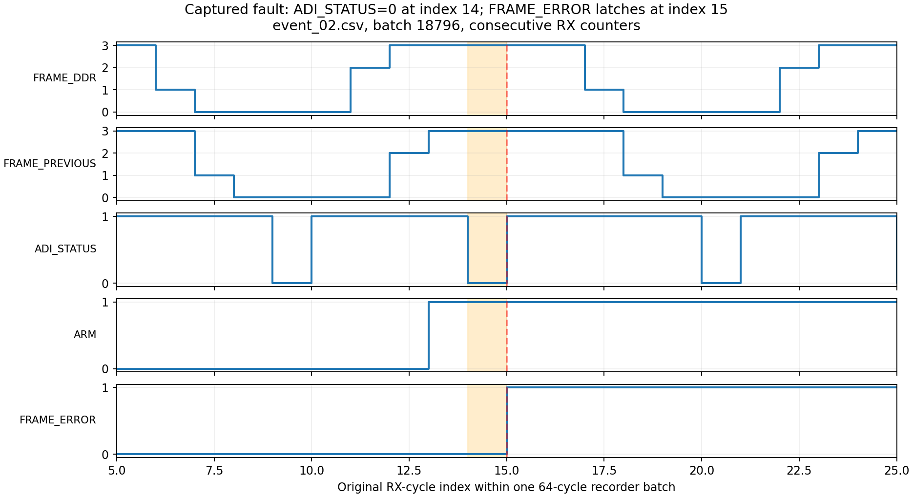

# FRAME_ERROR 与 IQ 连续性板测

日期：2026-10-16，Asia/Shanghai。板卡：当前连接的 xc7z035 / AD9361。

## 结论

**复现了实际 FRAME_ERROR；当前接收链路未通过数据连续性/完整性检查。**

这与 RECORD_VALID=0 时调试 RAM 保持上一条 IQ_VALID 的正常现象是两件事。
本报告所有记录统计均限定 RECORD_VALID=1；跨批次的正常空档不计为丢样。

## 保存的较长时间观测

- 14:04:35 起，轮询 64.49 秒，保存 60 份基线 CSV。
- 每份 ILA 深度 2048、时钟 200 MHz，即 10.24 us 的参考时钟窗口。
- 这是较长时间内反复抓取的独立窗口，不是无缝的 64 秒连续 RF 数据。
- 每个窗口里的 recorder 批次只有批内 64 个 RX 周期连续；不能跨批拼接。
- 共 122880 个 ILA 时钟点，50484 条有效回放记录，767 个完整批次。
- 有效记录中 IQ_VALID=1 有 16025 条，ADI_STATUS=0 有 8943 条。
- 此阶段 ARM 始终为 0，FRAME_ERROR 始终为 0。
- 同批且索引相邻的 RX_COUNTER 出现 40 处非 +1 变化；不能把它等同于丢了
  40 个 IQ 样本，但说明这些调试记录不能全部作为无误的连续性证据。

数据：[capture_times.csv](ila/capture_times.csv)、[baseline_analysis.json](baseline_analysis.json)。
首尾原生波形：[baseline_000.ila](ila/baseline_000.ila)、[baseline_059.ila](ila/baseline_059.ila)。
全部 CSV 在 `ila/baseline_000.csv` 至 `baseline_059.csv`。

## FRAME_ERROR 的触发原因及实测时序

RTL `ad9361_rx_axis.v`：

```verilog
else if (armed_rx) begin
    if (!ready_pipe[2]) delay_error_rx <= 1'b1;
    if (!official_status) frame_error_rx <= 1'b1;
end
```

因此，未 ARM 时接口状态虽会变低，也不锁存 FRAME_ERROR。
在 `ad9361_rx_lvds_if.v` 中，接口状态的生成链路是：

```verilog
assign rx_error = ^rx_frame;
adc_status_p <= ~rx_error & rx_locked;
```

采到 FRAME 两位为 01/10，会使这个帧检查报错；接口状态经过流水线后变低。

一个清楚的实测例子来自 [event_02.csv](ila/event_02.csv)，batch=18796。
这一批索引和 RX_COUNTER 均连续，故障位置如下：

| RX 索引 | RX_COUNTER | FRAME_DDR | FRAME_PREVIOUS | ADI_STATUS | ARM | FRAME_ERROR |
|---:|---:|---|---|---:|---:|---:|
| 11 | 12257364 | 10 | 00 | 1 | 0 | 0 |
| 12 | 12257365 | 11 | 10 | 1 | 0 | 0 |
| 13 | 12257366 | 11 | 11 | 1 | 1 | 0 |
| 14 | 12257367 | 11 | 11 | 0 | 1 | 0 |
| 15 | 12257368 | 11 | 11 | 1 | 1 | 1 |

索引 14 时，ARM 已为 1 且 ADI_STATUS=0；索引 15 时错误锁存。
之后即使 ADI_STATUS 恢复为 1，FRAME_ERROR 仍保持到复位。
这也说明不能只看故障那一拍的 FRAME 电平，而要考虑前级流水线。



直接导入 Vivado：[event_02.ila](ila/event_02.ila)。
绘图原始行：[frame_error_event_rows.csv](frame_error_event_rows.csv)。

## ARM 侧现有驱动采集与测试

没有修改工程 RTL 或现有应用源码。临时诊断入口加载到 PS DDR 0x02000000，
调用已经在板上运行的 ELF 中原有的 SPI、接收初始化、GPIO、DMA 函数。
运行前核对了原应用 main 的机器码和 CPU 在 `_exit` 的位置；保存并恢复 CPU 通用寄存器。
具体入口及地址在 `arm/diagnostic.c`，原应用和硬件摘要在 [artifact_hashes.json](artifact_hashes.json)。

每次 DMA 计划接收 256 包，即 8 MiB / 1048576 组四分量 IQ。
复用现有驱动的准备、启动、状态检查和故障退出流程，未将失败数据标为有效。

| 测试编号 | 模式 | DMA 启动 | 等待结果 | 故障后 GPIO | 完成包数 |
|---:|---|---:|---:|---|---:|
| 0 | 原普通 RF 接收 | 0 | -8 | 0x13 | 0 |
| 1 | 原普通 RF 接收 | 0 | -8 | 0x13 | 0 |
| 2 | 原普通 RF 接收 | 0 | -8 | 0x11 | 0 |
| 3 | RX 内部 Fs/16 数字音调 | 0 | -8 | 0x13 | 0 |
| 4 | RX 内部 Fs/16 数字音调 | -8 | 未进入等待 | 0x03 | 0 |
| 5 | RX 内部 Fs/16 数字音调 | 0 | -8 | 0x13 | 0 |

- -8 对应 `DMA_9361_ERR_CAPTURE`。
- 0x10 是 FRAME_ERROR；0x13 是 READY、接口状态以及 FRAME_ERROR 为 1。
- 测试 4 在启动流程第二次检查 GPIO 时失败，没有实际发出 ARM。
- 其余 5 次实际 ARM 后均捕获了帧错误，没有 overflow 或 delay_error。
- 六次均未完成一个 DMA 包；哨兵检查也没有发现完整写入 DDR 的 IQ 组。
  因此无法给出“DMA 长数据连续性通过”的结论。

另做一次 RX PRBS 注入（测试 6），调用原程序的 `rx_9361_check_pn` 观察 100 ms，
返回 -4，即 `RX_9361_ERR_PN`；四路通道状态均为 0x00000002（失步）。

结果：[arm_analysis.json](arm_analysis.json)。
执行日志：[diagnostic_final.log](arm/diagnostic_final.log)、[diagnostic_resume.log](arm/diagnostic_resume.log)。
`-999` 是诊断入口的“未执行该步骤”标记，不是驱动状态码。
`arm/trial_*_restored.bin` 保存每次测试及恢复后的结构体，`descriptors_*.bin` 保存 SG 描述符。
`payload_*.bin` 是诊断缓冲区快照，不是成功采集的数据文件。

## ILA 中的数字音调周期检查

采用工程原 BIST 自检的 16 样本周期条件：在同一 recorder 批次内，
仅使用 RECORD_VALID=1、IQ_VALID=1、CORE_RESET=0 的 IQ，比较相隔 16 组的每个分量。
任何 RX_COUNTER 非连续的批次整批排除，不跨批次比较。

| 抓取文件 | 使用的 IQ 组数 | 分量比较次数 | 不一致次数 |
|---|---:|---:|---:|
| event_03.csv | 276 | 260 | 238 |
| event_05.csv | 276 | 272 | 227 |

这两份记录的 RX_COUNTER 都连续，但所记录的有效 IQ 序列不满足预期周期。
这是记录侧的数据完整性失败证据；结合独立 ARM 侧 PN 失步，当前链路不能验收。
这些结果仍不足以单独区分外部接口时序/配置与调试记录链路的全部根因。

详细结果：[tone_period_analysis.json](tone_period_analysis.json)。

## 排除的数据与工具处理

测试 4 没发出 ARM，ILA 等待超时。该次工具返回了上一份数据，
`event_04.csv` 与 `event_03.csv` 的 SHA256 相同，已明确排除，不算第六次故障捕获。
说明见 [invalid_captures.json](invalid_captures.json)。
抓取脚本已增加 FULL 状态检查，防止把旧缓冲区误存为新结果。
Vivado 的 `wait_on_hw_ila -timeout` 单位为分钟，脚本使用 0.1 分钟的有界等待，
依据 [2020.2 命令文档](https://docs.amd.com/r/jNAIYEKDr3MtkPafPidAqQ/AHFcYOmzT~4_HwpDAqk1rQ)。

## 恢复状态

- 每轮测试均恢复并回读 3F4=0x53、3F5=0x00、3F6=0x30，恢复结果为 0。
- 最终 ARM 命令为 0；采集 GPIO 读回 0x03，未锁存采集错误。
- DMA 已复位为停止状态；接收核复位寄存器为 3、控制寄存器为 0（2R2T）。
- FCLK0 复位也影响 RIS GPIO，已按未改动的软件对象恢复其原命令 0x80000000。
- CPU 恢复原寄存器并继续运行原 `_exit` 循环。
- ILA 触发比较值恢复为 don't-care，触发位置恢复为 1024。

最终核对日志：[final_restore_check.log](arm/final_restore_check.log)。
恢复后新抓取：[restored.csv](ila/restored.csv)、[restored.ila](ila/restored.ila)。

离线重算：

```bash
python analyze_ila.py
python analyze_arm.py
python analyze_events.py
```

`arm/diagnostic.elf` 的绝对函数地址只适用于本次核对过的原应用 ELF；
应用重新链接后，复现测试需要重新生成地址，不能直接复用。
