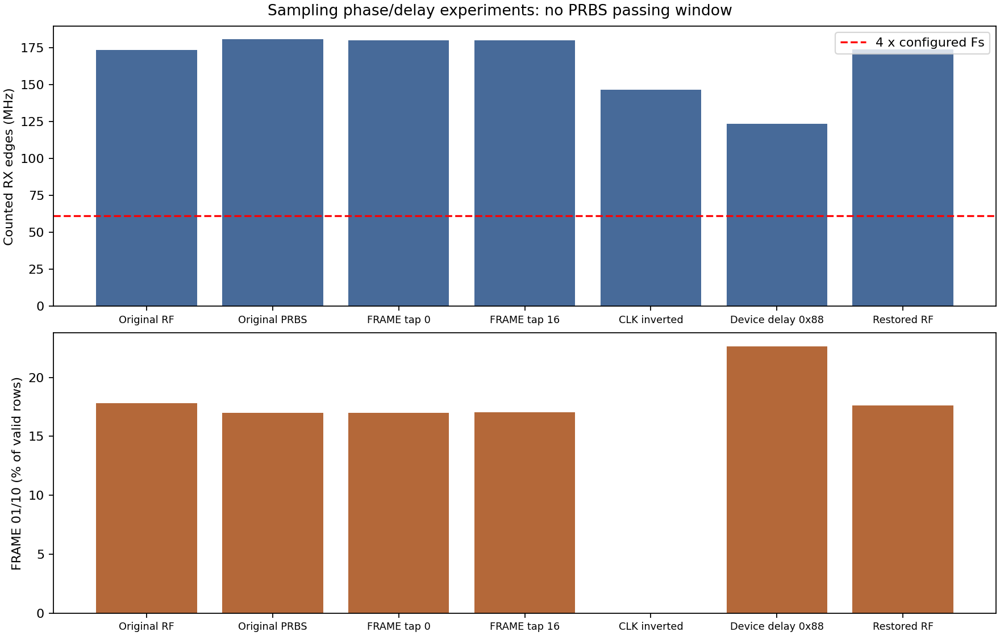

# AD9361 输入采样时序排查

2026-10-16，Asia/Shanghai。使用当前 xc7z035 板卡、原 BIT/LTX 与原 ARM 应用。

## 结论

**采样边沿确实影响 FRAME 检查，但本轮没有找到能通过 PRBS 的延时/极性设置。**
只将 AD9361 DATA_CLK 反相，抓取段中的 FRAME 01/10 和 ADI_STATUS 低电平均消失；
四路 PRBS 仍失步，且内部收到的时钟边沿率发生了明显变化。
因此当前证据优先指向接收时钟/数字接口输入层，尚不能确定具体硬件根因，
也不能据此宣布后级流水线或调试记录路径完全无误。

## 实际执行

全程保持采集 ARM=0、DMA 停止。临时诊断入口放在 PS DDR 0x02200000，
调用原应用中的 SPI、IDELAY 和 PN 检查函数；不重新烧写 FPGA，不修改工程 RTL 或应用源码。
运行前核对原 main 机器码及 `_exit` 位置，保存/恢复 CPU 通用寄存器。
本次完整日志：[sampling.log](arm/sampling.log)。

| 项目 | 测试数量 | PN 通过 |
|---|---:|---:|
| 仅扫 FPGA FRAME 延时 0..31 | 32 | 0 |
| AD9361 两种时钟极性 × 16 个时钟延时 × 16 个数据延时 | 512 | 0 |
| FPGA DATA 延时 0..31 × FRAME 延时 0..31 | 1024 | 0 |
| 原配置、选定条件复测 | 5 | 0 |

共 1573 次有界 PN 检查，四路通道状态均为 0x00000002（失步）。
另有 10 次原普通 RF 条件的计数测量和一次恢复后测量，总计 1584 行实验记录。

每个点先稳定 200 us，使用 ARM 全局定时器测约 5 ms 内的 RX 边沿计数，
再调用原 `rx_9361_check_pn(...,1000)`。所有寄存器写入均回读核对。
数据：[scan_points.csv](scan_points.csv)、[analysis.json](analysis.json)。

## 模式及 RTL 核对

原 SPI 实际读回：

| 寄存器 | 值 | 用途 |
|---|---|---|
| 002 / 003 | DE / DE | TX/RX 通道使能及数字滤波速率配置 |
| 006 | 0F | 原 DATA_CLK / RX_DATA 延时 |
| 009 | 07 | 时钟使能，XO_BYPASS 未置位 |
| 010 / 011 / 012 | C8 / 00 / 10 | 并行数字接口配置 |
| 03C | 21 | LVDS 偏置/端接配置 |
| 03D / 03E | 00 / 00 | LVDS 反相配置 |
| 3F4 / 3F5 / 3F6 | 53 / 00 / 30 | 原 TX 测试信号及观测/掩码设置 |

010=C8、011=00、012=10 与官方 UG-570 图 79 的 2R2T LVDS 示例一致，
不能把 C8 中某个位单独解读成模式配置错误。
参见 [UG-570，第 109–110 页](https://www.analog.com/media/en/technical-documentation/user-guides/ad9361.pdf)。

FPGA 的控制寄存器 0x82000044=0，选择 2R2T；四路通道均使能。
`ad9361_rx_lvds_if.v` 的 FRAME 和六路 DATA 都使用 `ad_data_in` 的
IBUFDS → IDELAYE2 → IDDR 路径，默认 IDDR 模式为 SAME_EDGE。
FRAME/DATA 的前一拍寄存器在同一个 always 块中更新。

注意：`adc_ddr_edgesel` 在当前 LVDS 模块中仅声明为输入，未参与采样逻辑。
所以切换该 PL 控制位并不能改变实际采样边沿，本轮改用 AD9361 的
INVERT_DATA_CLK（010 bit0）和真实延时单元进行比较。

延时扫描方法依据 [ADI AN-1441](https://www.analog.com/en/resources/app-notes/an-1441.html)：
使用已知 PRBS，改变芯片 006 的时钟/数据延时及 FPGA 输入延时，寻找通过窗口。
本轮没有发现通过点。

## ILA 对比

每个条件保存三份新的完整 ILA 缓冲区，共 21 份 CSV；每个条件另保存一份原生 `.ila`。
每份深度 2048，200 MHz，即 10.24 us；只统计 RECORD_VALID=1 的行。

| 条件 | 有效回放行 | FRAME 为 01/10 | ADI_STATUS=0 |
|---|---:|---:|---:|
| 原普通 RF | 2521 | 449 | 451 |
| 原接口配置，RX PRBS | 2527 | 429 | 430 |
| FRAME tap=0 复测 | 2622 | 446 | 447 |
| FRAME tap=16 | 2596 | 443 | 438 |
| **DATA_CLK 反相，006=0F** | **2302** | **0** | **0** |
| 芯片时钟/数据延时 006=88 | 2230 | 505 | 498 |
| 恢复原配置后的普通 RF | 2520 | 444 | 450 |

DATA_CLK 反相的抓取：[condition_04_PRBS_clock_inverted_0.ila](ila/condition_04_PRBS_clock_inverted_0.ila)。
原 PRBS 条件：[condition_01_PRBS_original_0.ila](ila/condition_01_PRBS_original_0.ila)。
恢复后：[condition_06_restored_original_0.ila](ila/condition_06_restored_original_0.ila)。

condition_02 的文件名保留脚本原标签 `PRBS_best_frame`，实际为 FRAME tap=0 的复测，
不代表找到有效眼图中心。最初用于选点的 AXI 状态轮询无法分辨瞬态错误，原因见下文。

除 FRAME 外，分析脚本还按批次检查了前一拍 FRAME、两拍解帧流水线和
48→64 位符号扩展。大多数记录符合 RTL 关系，但仍有少量不一致和 RX_COUNTER 跳变；
详细计数保留在 analysis.json。它们使我们不能仅凭这组调试记录排除全部内部时序/记录问题。
跨批次空档不作为丢样；RX_COUNTER 不连续的批次不参与流水线重建比较。

## 更值得追查的时钟边沿异常

芯片时钟寄存器读回计算得到：BBPLL≈983.04 MHz、ADC≈245.76 MHz、Fs≈15.36 MSPS。
双通道正常有效 LVDS 传输的 4×Fs 为 61.44 MHz。

但 FPGA 内计数结果为：

| 条件 | ARM 全局定时器测得的 RX 边沿率 |
|---|---|
| 原普通 RF，10 次测量 | 173.087～174.215 MHz，均值 173.686 MHz |
| 原配置，RX PRBS | 180.746 MHz |
| 仅反相 DATA_CLK，RX PRBS | 146.586 MHz |
| 006=88，RX PRBS | 123.481 MHz |
| 恢复原配置后的普通 RF | 173.976 MHz |

另一套 ADI clock monitor 与 ARM 定时器测量相符。尤其是同样的 PRBS 数据模式下，
只改变时钟极性，内部边沿率就从约 180 MHz 变到约 147 MHz。
反相本身不应改变时钟频率，因此不能将这一现象解释为后级处理速度不够。

这些是 FPGA 内部的数字计数结果，不是示波器对 AD9361 引脚频率的测量。
它们不能单独证明 AD9361 真正输出了上述频率；接收端的额外/缺失边沿、波形质量、
端接、引脚连接和接口时钟配置都仍需要进一步区分。
现有 XDC 设置 DIFF_TERM=false，本轮保持该配置，未尝试更改 IO 电压或端接。



## 时基核验

只读 PS 寄存器结果：[timebase.log](arm/timebase.log)。

- ARM_PLL_CTRL=0x00028008、ARM_CLK_CTRL=0x1F000200，与原 ps7_init.tcl 一致。
- IO_PLL_CTRL=0x0001E008、FPGA0_CLK_CTRL=0x00200500，也与初始化一致。
- 按工程的 PS 参考时钟配置，CPU 为约 666.667 MHz，全局定时器约 333.333 MHz，
  FCLK0 为 100 MHz，与编译使用的时基一致。
- 未发现 PS 分频被意外改变来解释上述边沿率偏差。

## 为什么 AXI 状态轮询看起来一直正常

0x8200005C 的接口状态经过 `up_xfer_status` 传输。该模块会按位或累积状态：

```verilog
d_acc_data <= d_acc_data | d_data_status;
```

所以窗口内出现过正常状态，就可能让处理器读到 STATUS=1，短暂的 0 被掩盖。
`scan_points.csv` 中的 `axi_status_low=0` 不能解释为零帧错误。
本报告判断采用原始逐周期 ILA 和独立 PN 检查；没有用该轮询值作为通过标准。

## 恢复与源码状态

SPI 010、006、3F4、3F5、3F6 和七路 FPGA 延时均保存并回读恢复。
恢复结果 0，最终采集 ARM=0、GPIO 状态=0x03；CPU 已恢复原寄存器并继续原程序。
没有保留时钟反相设置，没有修改工程 RTL 或原应用源码。
原 BIT/LTX、RTL 与应用 ELF 的 SHA256 记录在 [artifact_hashes.json](artifact_hashes.json)。

离线重算：`python analyze_sampling.py`。
临时诊断 ELF 的绝对函数地址仅适用于本次核对过的原应用 ELF，重新链接后需更新。
